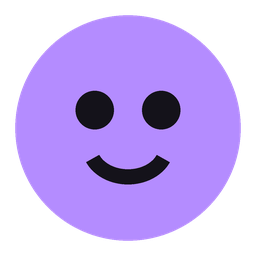

#  VTOverlay

Put your VTuber avatar on a friend's desktop, live.

You run **VTOverlay** with your webcam; your friend runs **VTOverlay Viewer** with your room code, and your VRM avatar appears on their screen, moving with your head, eyes, mouth, expressions, and (optionally) arms and fingers. It can float as a small see-through widget, sit in a normal window, or roam a whole monitor where *you* place it.

Peer-to-peer, no account, no server of your own needed. Your webcam image never leaves your PC.

---

## Download

Grab the latest version from **[Releases](https://github.com/Kiriuno/VTOverlay/releases/latest)**:

| File | For |
|---|---|
| `VTOverlay-win32-x64.zip` | the broadcaster (can also view) |
| `VTOverlay-Viewer-win32-x64.zip` | friends who only watch (smaller, no webcam code) |

1. Unzip it into a folder you own, such as `Documents\VTOverlay` or your Desktop. Avoid `Program Files`, because the app needs to be able to update itself there.
2. Run `VTOverlay.exe` / `VTOverlay-Viewer.exe`.
3. Windows SmartScreen may warn the first time because the app isn't code-signed. Click **More info → Run anyway**.

**Updates:** the start screen checks this repo's latest release every time it opens, including when you come back to it after broadcasting or watching. If there's a newer one, it shows *Update available*: click **Update now** and the app downloads it, replaces itself and restarts (**Cancel** stops a download in progress). A release that comes out while you're broadcasting shows a notice in the sidebar. **Check for updates** is at the bottom of the start screen. If files are still in use, the app restarts on your current version and tells you to try again.

---

## Broadcasting (you)

1. **Start broadcasting** and load your `.vrm` (button or drag & drop). Free models can be made in [VRoid Studio](https://vroid.com/en/studio).
2. Look at the screen with a relaxed face and press **Calibrate**.
3. Send your friend the 6-character **room code** (**Copy** button; **Hide** masks it on screen, e.g. while streaming, and Copy still works). It stays the same between launches. **Max viewers** optionally limits how many people can watch; anyone extra is told the room is full and gets in as soon as a spot frees up.
4. Frame the shot in your preview. Viewers see exactly this framing:
   - scroll to zoom
   - middle-drag to move the avatar
   - right-drag to rotate it
   - **Framing: Bust / Full body** and **Reset view** buttons

| | |
|---|---|
| **Move mouth with my voice** | (Tracking section, off by default) Your microphone opens the avatar's mouth while you talk, rounder for dark sounds and wider for bright ones, on top of face tracking. Pick the microphone and the sensitivity; a small meter shows what it hears. |
| **Pause tracking** | Turns the camera off when you step away. Viewers see your avatar idling (breathing, blinking). Can have a hotkey. |
| **Sensitivity** | Mouth, blink, each vowel (A, E, I, O, U), each with a **limit** slider next to it that hard-caps how far that shape can go (e.g. the mouth never opens past 50%), and how much the body follows your head up/down, left/right and forward/back. **Remembered per avatar**: switching models switches their settings (a new model starts from your current ones). Per-expression mouth/blink tuning is part of it too. |
| **View** | Scroll to zoom, middle-drag to move, right-drag to turn (all the way round, as many times as you like). **Roll** turns the whole picture: sideways, upside down… (buttons, slider, or Shift+right-drag). The **Reset** buttons at the top reset the position, the size (zoom), the rotation, or all of it. |
| **Pose** | Standing, relaxed (weight on one leg), walking, the griddy (dance), the 6 7 (hands out palms up, bobbing up and down in turn), sitting on a chair with or without crossed legs, sitting on a chair, sitting on the floor, kneeling, or sitting back on the knees (feet out to the sides). Your head, face and arm tracking keep working on top of it, and it fades smoothly from one pose to the next. While the camera doesn't see your hands, the pose places them: relaxed has a hand on the hip, sitting (crossed legs too) has them on the thighs, on the floor on the knees, sitting back on the knees on the thighs (standing, walking and kneeling leave the arms relaxed at the sides). Arm tracking only takes over while the camera sees the hand. Fingers rest in a relaxed curl with a little idle movement. In bust framing the camera follows your face down when you sit. Viewers see the same pose. |
| **Lighting** | Colour and brightness of the main light, where it comes from (left/right, below/above, **behind/front**), plus a fill light for the shadows. Save your setups as **presets**. Viewers see the same lighting. |
| **Smoothing** | Less jitter vs. more responsiveness. **Link both eyes** stops accidental winks. |
| **Expressions** | Every expression your model has gets a button; click to toggle. **Right-click** an expression (or *neutral*) to give it a hotkey (Alt+H, Ctrl+Alt+1, F9…); hotkeys work from any app. There are no default hotkeys, only the ones you set. While an expression is on, you can tune its **mouth movement** and **blinking**, so a closed-eye smile doesn't blink, for example. That tuning also applies when the same expression comes from auto expressions, as strongly as it shows. **Auto expressions** reads happy / sad / angry / surprised from your face (several cues each, the strongest one shows). It learns how your face looks when relaxed as you go, so a face that rests a little smiley isn't read as happy all the time, and it reacts to smaller frowns and lowered brows for sad and angry, which webcams pick up faintly. Auto expressions go all the way by default; **Subtle auto expressions** (under the switch) keeps them softer, never at full strength. **Auto expressions: sensitivity** has a slider and a live meter per emotion so you can tune it to your face, plus **Calibrate** per emotion: make that face the way you normally do, click and hold it 2 seconds, and that becomes its full strength (good for one that never goes all the way); **Reset** undoes it. |
| **Props** | Add PNG / JPG / GIF / WebP images (animated ones play). Each prop stays in the scene or is attached to a body part. Attached ones have a **follow strength** (1 = moves exactly with it, 0.5 = halfway, 0 = stays put) and can stop following its **position** (it stays in place but still turns exactly as before) or its **rotation** (it moves exactly as before but keeps its own angle). Rotate them on all three axes. **Draw** says where it shows: *in front of the avatar*, *behind the avatar*, or *by distance* (its real 3D position, so it can sit e.g. between an arm and the body; only then is there a **Distance** slider). Among props drawn the same way, the one higher in the list is in front: ▲ brings forward, ▼ sends back. Put props in a **group** to show/hide them all with one hotkey. Click a prop's bar in the list to open its settings, click it again to close them. In the preview: drag to move, scroll to resize, Shift+scroll to rotate. 🔒 locks a prop; **Lock all** locks every prop. |
| **Arms & hands** *(beta)* | Follows your arms and fingers when they're in the camera view. Landmarks are filtered (steady when you hold still, quick when you move), and **Arm & hand smoothing** sets how much. The camera switches to 720p while it's on, because hands need the pixels. |
| **Out of view** | Step out of frame or turn your head far away, and your avatar keeps its last pose (still blinking) until you're back. If tracking drops while you're in front of the camera, or you pause, it relaxes back to rest as before. |
| **Interactions** | Left-drag hair, a skirt, a ribbon… to pull it (you can do this in your preview too). Viewers can also give **headpats**: rubbing the mouse back and forth over the head, quickly enough and for a moment (just passing over it slowly does nothing), squishes it under a patting hand, faster or slower with their rubbing (from half to two and a half times the normal 2.6 pats per second); overshooting the head a little doesn't stop it, and props don't squish. Clicking the nose is a **boop**: a little scrunch and a few tiny stars. With **Let viewers slap your bottom** on (off by default), a quick swipe of the mouse across the avatar's bottom while it's seen from the side or behind is a **slap** (not a click, so the springs there can still be grabbed): the spring bones there (skirt, tail, long hair…) get knocked the way the mouse was going and swing back and forth for a moment, whole chains at once, and the legs wobble a tiny bit with the feet staying planted. **Spring bones that wiggle on a slap** (under that switch) lets you pick which spring chains react, per avatar (Auto = the ones near the bottom or hanging off the hips), with a button to test it in your preview. Everyone sees all of it. Viewers can pull hair only if you tick **Let viewers grab hair & clothes** (off by default); headpats & boops have their own switch (on by default). The head/nose areas are found automatically; **Adjust headpat, boop & slap areas** fine-tunes them (up/down, forward/back, size). *The headpat hand:* put the classic headpat gif at `assets/headpat.gif` (it isn't included) and it's used automatically, timed to the pats; otherwise a drawn hand is used. |
| **Camera output** | **Open camera output** opens a clean window with just your avatar on a green (or blue, magenta…) background, 720p / 1080p / square / vertical. In OBS: *Window Capture* of “VTOverlay Output” → *Filters → Chroma Key* → **Start Virtual Camera**, then pick **OBS Virtual Camera** as your camera in Discord, Zoom, Meet… |
| **Performance** | Memory and CPU of each part of VTOverlay (broadcaster window, graphics, camera output, Show on my screen…), refreshed every few seconds while the panel is open, with how much each one grew since you opened it. |
| **Viewers** | Each viewer shows what they actually see: *Loading your avatar… 42%*, *● Sees you*, or *Avatar hidden* (full screen, you're not tracking). |
| **Place on viewer's screen** | For friends in Full screen mode: drag your avatar around their monitor and resize it. Their taskbar is shown as a strip; the avatar's feet **snap onto the top of the taskbar**, keep pushing to go over it. **Add image…** (or dropping an image here) puts a picture on their screen: drag it anywhere, scroll to resize; it always faces them and can be in front of or behind the avatar. They can share that screen with you so you see where you're putting things. The **Reset** buttons reset the position, the size, or both. **Show on my screen** (only while the viewer picked here is in Full screen mode) puts your avatar full screen on your own monitor at exactly the same place and size as on the viewer picked here (click-through, like theirs; with several screens, pick which of yours once it's on). If that viewer leaves Full screen mode or disconnects, yours closes too. In a room with co-hosts and no viewer in Full screen mode, **My screen** takes the viewer's place here (it isn't a viewer and isn't in the Viewers list): place everyone on your own screen and show it there. When a viewer switches to Full screen they replace it, and if nobody has placed them before, they start where you had everyone on My screen. Co-hosts can use **Show on my screen** too; theirs always follows the host's own screen, with the host's placement (and their own, if the host lets co-hosts place themselves), and they can only touch their own avatar on it. A normal broadcast without co-hosts works as before. It stays on top of your other windows, and you can pat, boop, slap and pull hair on it like a viewer (with the same permission switches). While it's open, your avatar isn't loaded in the **My avatar** preview at all, to save resources (zooming, moving and turning there still work; pull hair on your screen), and co-hosts beside you are hidden there too. |

### OBS only

**OBS only** on the start screen is for when you only want your avatar in OBS (or a virtual camera for Discord, Zoom…), with no viewers. The camera output opens by itself, and there's no viewer list and no placing on someone's screen. With **Avatars in the room** on **Just me**, nothing leaves your computer (no room code). Pick 2 to 5 and you get a room code so friends can **Join with my avatar** as co-hosts: they appear next to you in the camera output. Viewers who try that code are told you're only using OBS.

### Several avatars in one room

Up to 5 people can stand in the same room, each with their own avatar.

- **The host** presses **With co-hosts** on the start screen (instead of Start broadcasting; **OBS only** can take co-hosts too) and sets **Avatars in the room** (2 to 5) next to the room code. A normal broadcast doesn't take co-hosts.
- **Joining with your avatar**: on the start screen, type the host's code and press **Join with my avatar** (instead of Join). You get the broadcaster window as usual: load your avatar, track, set your expressions, props and interaction switches. Your avatar appears next to the host's, for everyone.
- **One row**: everyone stands side by side. **Move left / Move right** (Avatar section) swaps places with your neighbour; the buttons grey out at the ends of the row. Your preview keeps you in the middle with the others beside you; **Hide the others in my preview** hides them there only (nobody else is affected). Viewers, floating widgets (they widen to fit everyone) and the camera output show the whole group, centred.
- **Your own view**: in **My avatar**, zooming, moving and turning only change your own avatar (everyone sees it that way). The host decides the framing (bust or full body) and the **roll**, which turns the whole row around its middle (at 90° the row becomes a column), plus the lighting, who watches and who stays. The host can remove a co-host (✕ in the Viewers section).
- **Who's in front**: the avatar that looks bigger on screen (taller model, or zoomed in more by its owner) stands further back, the smaller one in front. Zoom a small avatar until it's the bigger one and it goes behind. Two exactly the same size share one layer (each avatar is drawn as its own picture, so where they cross one is simply drawn over the other; they can't pass through each other in 3D).
- **Same floor**: in a room everyone is framed from the same height, so feet line up: a kneeling or sitting avatar is lower than a standing one, and a small avatar is smaller than a tall one.
- **Full-screen viewers**: by default the row is placed as a whole (the host drags it in **Place on viewer's screen**). With **Co-hosts place their own avatar** on, each co-host moves and resizes their own avatar on full-screen viewers (the host can't move theirs then, only their own).
- **Interactions**: viewers can pat, boop, slap and grab every avatar; each owner's own switches decide what's allowed on their avatar. Everyone keeps their own props.
- Viewers need this version (0.9.0) or newer to see the co-hosts; older ones only see the host.

## Watching (your friend)

Type the code, choose how to show the avatar, then **Join**:

- **Floating**: a small see-through widget. Drag it, scroll to resize, **Ctrl+Alt+V** to lock it (click-through).
- **Window**: a normal window.
- **Full screen**: a click-through layer over a monitor. The broadcaster places the avatar. **Ctrl+Alt+V** opens the zone editor, which limits the avatar to part of the screen. If the broadcaster stops tracking for 30 seconds (paused, away from the camera, camera covered or turned off so the image is black, or disconnected), the avatar fades out, and it comes back as soon as tracking resumes. Images placed on the screen stay.

The **control window** (floating and full screen modes) has every action:
- switch mode or monitor
- edit the zone
- share the screen with the broadcaster (off by default)
- reconnect, disconnect, quit

**Frame rate** (control window): how often the avatar is drawn, 30, 45 (default) or 60 times a second. More is smoother, less is lighter on the CPU and GPU. **Low resource mode** (control window or tray menu) overrides it: 20 times a second, a lower resolution and smaller textures (capped at 1024 px, which also saves graphics memory). Both are remembered for next time.

**Allow interactions** (control window or tray menu) switches pulling, headpats and boops off on your side, so clicks always reach whatever is behind the avatar.

Its ✕ hides it to the tray (the ^ next to the clock). Click the tray icon to bring it back. **Quit** closes the app.

## Privacy

- **Webcam:** the image never leaves the broadcaster's PC. Viewers only receive numbers: head rotation and position, 52 face-shape weights, expression name, and arm/finger directions if enabled.
- **Model and props:** sent directly to viewers (peer-to-peer, encrypted) and cached there. Their file names are never sent. The cached models are scrambled with a key made on the viewer's PC, so they can't simply be found and opened as a .vrm, and release builds can't be opened with developer tools or a debugger. This makes copying your model hard, not impossible: anything drawn on someone's screen can be extracted by a determined person.
- **Screen sharing:** only happens if the viewer turns it on, and a "Sharing this screen" tag stays visible while it runs.

## Troubleshooting

- **Viewer stuck on "Room isn't online":** check the code. The broadcaster must have **Start broadcasting** open.
- **Stuck on "Can't reach the connection server":** the free PeerJS server (0.peerjs.com) that helps the two apps find each other is busy or down. The app keeps retrying by itself. Your room code stays the same, and viewers who are already connected keep watching. If it happens often, see *Your own signalling server* below.
- **Can't connect at all:** some networks block direct connections (phone hotspots, campus or work Wi-Fi, CGNAT). Those need a TURN relay; see *Advanced* below.
- **Wrong eye winks:** toggle **Swap left/right eyes & mouth**.
- **Hotkey shows red:** another app already uses that combination; pick another.
- **An update failed:** the details are in `%TEMP%\vtoverlay-update.log`. If it says files were in use, just click **Update now** again. Otherwise the usual cause is the app folder being in a protected place like `Program Files`.

---

## Building from source

Requires [Node.js](https://nodejs.org) 20+.

```bash
npm install
npm run dev              # a broadcaster + a viewer, already linked (dev rooms only, see below)
npm run dev -- --cohosts=2  # + 2 co-hosts joining with their own avatar
npm start                # run from source (broadcast + view)
npm run start-viewer     # run as the viewer-only app
npm run package-all      # build dist/VTOverlay-win32-x64 and dist/VTOverlay-Viewer-win32-x64
npm run release-zips     # same, plus the two zips a GitHub release needs
```

`npm run dev` starts both apps from your source folder with a fresh room code and joins the viewer to it. Dev apps use their own rooms (a different room-name prefix), so a dev broadcaster and a released viewer can never see each other, and the other way round. They also keep their own settings. Options: `npm run dev -- --mode=floating` (or `screen`), `--code=ABC123`, `--only=viewer`, `--cohosts=2` (1 to 4 co-hosts that join the dev broadcaster's room with their own avatar; the broadcaster starts with co-hosts enabled; each co-host keeps its own settings, so load a model in each one once and it's remembered), `--viewers=0` (no viewer), `--obs` (the broadcaster starts **OBS only**, no viewer; with `--cohosts=N` it opens a room for them). The viewer's connection status is printed in the terminal.

## How it works

```
 Webcam ─▶ MediaPipe (face, + pose & hands) ─▶ head pose, 52 blendshapes, arm directions ─┐
                                                                                         │  WebRTC (PeerJS), peer-to-peer
                        motion: unreliable channel, ~30 Hz, numbered, never queued        │  control/model/props: reliable channel
                                                                                         ▼
 Viewer: Electron window (transparent / normal) ─▶ three.js + three-vrm ─▶ your avatar + props
```

- **Tracking:**
  - MediaPipe FaceLandmarker gives the blendshapes and head transform. PoseLandmarker and HandLandmarker are added when arm tracking is on.
  - A One-Euro filter smooths the head and face.
  - Calibration records your resting face as zero.
- **Avatar:** VRM 0.x and 1.0 via `@pixiv/three-vrm`. "Perfect sync" (ARKit-named) models get all 52 shapes; others are mapped to the VRM presets.
- **Network:** the public PeerJS server is only used to find each other. Everything else goes directly between the PCs.
- **Updates:** `updater.js` reads `api.github.com/repos/Kiriuno/VTOverlay/releases/latest`, downloads the build's zip, and the new exe copies itself over the old folder.

**Files:**
- `main.js`: windows, modes, tray, hotkeys, updates
- `updater.js`: self-update
- `src/sender.*`: broadcaster
- `src/overlay.*`: viewer
- `src/panel.html`: viewer control window
- `src/launcher.html`: start screen
- `src/shared/`:
  - `avatar.js`: VRM animation
  - `props.js`
  - `arms.js`: arm / hand tracking and its filtering
  - `grab.js`: pulling hair & clothes
  - `fx.js`: headpats & boops
  - `room.js`: multi-avatar rooms (co-hosts)
  - `filters.js`
  - `protocol.js`: the message format, documented
- `src/output.*`: camera output window (OBS)
- `scripts/dev.js`: `npm run dev`

### Advanced

- **Your own signalling server:** run `npx peer --port 9000` somewhere and set `host` / `port` / `path` in `peerOptions()` in `src/shared/protocol.js`.
- **TURN relay** for strict networks: add it to `iceServers` in the same function.

## License

[MIT](LICENSE)
